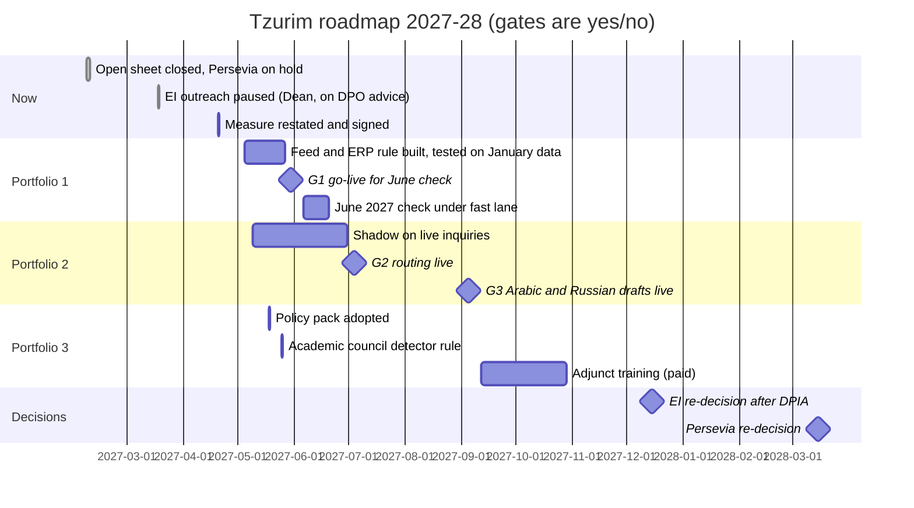

# 04 · Portfolio, ROI model and roadmap

*Expert deliverable. Version 2.1, 19 April 2027 (v2.0 of 1 April, netted with Avi Golan on 25 March; v2.1 adds ₪25k of Arabic draft review time to portfolio 2 after the integration check, IC-02). ₪ at 2025-26 tuition; contribution 70% of tuition (Avi Golan, measured on 2025-26 sections, directional for 2027-28). Labels: M measured, D directional, A assumed.*

## Opportunity map (three feeds)

| Candidate | Feed | Type | Fast screen | Verdict |
|---|---|---|---|---|
| Vendor early-warning system (Persevia) | Top-down (CEO) | AI prediction | Fails the data gate (no signed label), the lever test and the data boundary | Not yet (re-decide March 2028) |
| Tavla Engagement Insights for outreach | AI already in use | AI prediction inside SaaS | Fails fairness, lawful basis, lever | Stop outreach use now |
| Block fast lane: approved grants never block; arrangements in 3 working days; block inquiries straight to collections | Findings | **Plain automation and process, no AI** | Passes: data exists, lever is the college's own rule | **Portfolio 1** |
| Rule-based adviser alert (first-year blocked at check; missed two exams) | Findings + SS-03 | Plain rule, no AI | Passes | Part of portfolio 1 |
| Inquiry triage and drafting in the student's language, staff send | Requests (service centre, union) | Generative AI, assist | Passes with conditions (human sends, no decisions) | **Portfolio 2** |
| Approved general assistant for staff and adjuncts, with rules | AI already in use (shadow) | Generative AI, augment | Passes with the policy pack | **Portfolio 3** |
| AI course-evaluation summaries | AI already in use | Generative AI | Adjunct committee objects; no DPA | Switch off until agreed |
| AI detector for misconduct | AI already in use | AI classification | Fails: evidence quality, fairness | Not as evidence (academic council) |
| Admissions CRM lead score | AI already in use | AI prediction inside SaaS | Out of scope; inventory and review | Inventory, DPO review |

## Scorecard (criteria locked 1 March; 1–5)

| Criterion (weight) | Fast lane | Inquiry assistant | Staff assistant | Persevia |
|---|---|---|---|---|
| Value to the board's question (30%) | 5 | 3 | 1 | 2 |
| Evidence the value is real (20%) | 4 (M association) | 3 | 2 | 1 |
| Data ready (15%) | 5 | 4 | n/a → 3 | 1 |
| Risk after controls (15%) | 5 | 4 | 3 | 1 |
| Absorption: units can take it on (10%) | 3 (collections desk peak) | 4 | 3 | 2 (advisers) |
| Cost and time (10%) | 5 | 4 | 4 | 2 |
| **Weighted** | **4.6** | **3.5** | **2.4** | **1.5** |

## ROI model (academic year 2027-28; summary of `roi-model` sheet)

**Portfolio 1 — block fast lane.**

| Line | Value | Label |
|---|---|---|
| Excess leavers associated with block-missed registration (2025-26): first-year 353 × (33.7% − 7.6%) = 92; second-year 281 × (17.1% − 3.7%) = 38; third-year 262 × (7.6% − 2.1%) = 14 | 144 a year | M |
| Share of block-missed registrations the fast lane removes (blocks that are grant timing) | 60% | M (share of blocks), A (that removing them removes the misses) |
| Credit taken for the association (not proven causal) | 50% | A |
| Students retained | 144 × 60% × 50% ≈ **43** | D |
| Remaining contribution per retained student: first-year ≈ ₪42,000 (2 years × ₪29,900 avg × 70%), second ≈ ₪21,000, third ≈ ₪5,000; weighted ≈ ₪32,900 | | D |
| **Value per intake year** | **≈ ₪1.41M** (range ₪0.7M at 25% credit, ₪2.8M at 100%) | D |
| Cost year 1: grant-approval feed to the ERP ₪70k; ERP rule "approved grant counts as paid" ₪25k; temporary collections staff in two block windows ₪30k; adviser alert ₪15k; portal routing rule ₪10k | **₪150,000** | A (quotes pending) |
| Ongoing | ₪40,000 a year | A |
| Bad debt | Unchanged: the block stays for real arrears | A, monitored (gate) |

**Portfolio 2 — inquiry triage and drafting.** Value is capacity and service, not cash: about 720 reassignments a year at about 20 minutes each (≈ 240 hours) plus drafting about 6 minutes on about 2,700 inquiries (≈ 270 hours) ≈ **510 staff hours a year (capacity, D)**; Arabic replies in Arabic; block inquiries reach collections on day 0 (counted in portfolio 1, not here). Cost year 1 **₪135,000** (configuration and portal integration ₪70k, eval and shadow ₪25k, training ₪15k, review time ₪25k); 40 seats from the 39 unused office AI licences, cost-neutral (A, IT to confirm); model tokens about ₪60 a year at about 2,700 inquiries (D, `06`).

**Portfolio 3 — governance and approved staff tool.** Risk reduction, not monetised: policy pack, DPIA, notice ₪85,000; two paid hours of training for 328 adjuncts and the service centre ₪110,000 (328 × 2 h × ₪160 + materials). The office suite's included chat assistant under the college's data terms is the approved tool (IT confirmed 22 March; no extra licence cost).

**Persevia, netted at its own claim.** Core 36 months: US$38,000 + 3 × US$58,500 = US$213,500 ≈ **₪669,500** (≈ ₪223k a year) with automatic renewal. Its ₪10.6M a year is gross tuition × 3 years × 120 students; netted at 70% contribution over two remaining years it would be ≈ ₪4.9M (120 × ₪29,400 × 2 × 70%) — if every flagged student who stayed would otherwise have left, which its own case study cannot show. It does not touch the block, which is behind 45% of first-year leaving.

**Total asked from line 6800-110: ₪540,000** (P1 ₪150k, P2 ₪135k, P3 ₪195k, measure and dashboard ₪30k, contingency ₪30k). Payback of P1 alone within one academic year at the low end (D).

## Roadmap

| Gate | Yes/no condition | Frees or proves for the next |
|---|---|---|
| G1 (30 May) | Feed tested on the January 2026 data: every approved-but-unposted grant in the 718 cases would have been credited before the check; collections agrees to 3-working-day arrangements | Proves the June 2027 check can run without timing blocks |
| G-June (20 Jun) | Blocks at the June check ≤ 300 (643 in June 2026); block-missed registrations down ≥ 50%; bad debt provision unchanged | Evidence for the 2028 budget and for the measure |
| G2 (4 Jul) | Routing ≥ 90% on the test set, finance recall ≥ 95%, urgent recall ≥ 95% in shadow; 20/20 negative tests | Frees collections from reassignments before September |
| G3 (5 Sep) | Arabic and Russian drafts rated acceptable ≥ 80% by the Arabic-speaking staff; reopen rate in shadow below 15% | Arabic service at Hebrew speed |
| EI (15 Dec) | DPIA approved; drivers from accommodations removed; fairness test passed; notice published | Whether any score is used for outreach |
| Persevia (Mar 2028) | Bar criteria 1–7 met; vendor accepts PoC conditions (de-identified, EU/Israel, no training licence, no auto-conversion) | Whether to run a PoC |

**Review capacity per quarter:** the DPO has about 8 hours a month (two DPIAs a quarter at most); IT's four developers are on the ERP feed in May; nothing new goes live in the June exam weeks or over the autumn holidays (October 2027).
