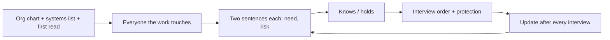

# 02.1 · Stakeholder map before the first interview

Before you book a single interview you need to know who can shape, block, absorb or suffer from what you are about to do, and what each of them wants and fears. In this lesson you build that map for Harbor & Pine from the org chart, the systems list and the data room, write every stakeholder's need and risk in two sentences, and turn the map into an interview order. At the end you have a one-page stakeholder map and a two-week interview plan you can send to your sponsor.

## The situation

It is Thursday 5 November 2026, the end of your first week. Michal Peretz, the COO, approved your 30-60-90 plan at this afternoon's check-in (01.4). Its first block asks one question — what is really happening in the work, the data and the AI already in use — and promises "interviews with 8–10 people" before the findings memo on 1 December. You have read the data room (01.5) and run the shadow-AI census (01.6). You have not yet sat down with anyone except Michal.

Michal's offer: "Tell me who you want to see, and I'll send the invitations." That is the moment to have a map. If you let the org chart pick your interviews you will see the managers, hear the official process and miss the people who keep the real numbers in a spreadsheet.

IBM's consulting certificate calls this the stakeholder map with a two-sentence test: for each role, what they need to call it a win and what they risk. Here you build one on real files, add the people an org chart leaves out, and use it to decide who you see first.

> [!NOTE]
> A stakeholder map holds opinions about named colleagues. Keep it in the program folder, not in
> a shared deck, and write stances as observations with evidence ("asked in the board minutes"),
> never as judgments of character.

## What to do

### Step 1 — List everyone the program touches (20 minutes)

Start with three sources and one question each:

1. **The org chart** (`company/org-chart.md`, `people/headcount.csv`): who decides, who manages the teams in scope, who reports to whom. At Harbor & Pine: Yoav Ben-Ami (CEO), Michal Peretz (COO, your sponsor), Ronit Avraham (CFO), Samir Haddad (Customer Service, 14 people), Tamar Shalev (Logistics & Warehouse, 44), Noa Levi (Marketing & E-commerce), Avi Mizrahi (IT, reports to Ronit), Dana Katz (HR), Eyal Navon (Purchasing).
2. **The systems list** (`company/company-profile.md`, `it/saas-list.csv`): who owns each system the work runs through. StoreHub, where the promised delivery date is set, belongs to **Marketing**, not to operations. Deskly and CloudVoice belong to Customer Service; Priority to Finance.
3. **The data-room first read** (01.5): who produced each file. The hand-kept files have individual owners: Tamar's container sheet (`orders/logistics-eta-tracking.csv`), Rina Azoulay's claims log (`claims/damage-claims-log.csv`). The web-store settings file shows the lead times were last changed in February 2023 by `noa.levi`.

Then ask the question the org chart cannot answer: **who does the work touch that is not on this page?** Four kinds of people are almost always missing:

- **The receiving team** — whoever absorbs work your program moves or creates. The logistics mailbox export (`documents/internal-emails-logistics-mailbox.md`) shows support agents emailing logistics about single orders, and Tamar writing to Samir that her team got 41 such emails in one week. Itai Mekonen, an import coordinator, answers most of them. He is a stakeholder even though nobody would invite him to an AI meeting.
- **The keeper of the hand-made file** — Rina, whose claims log is the only record of claim decisions; Tamar, whose sheet is the only place the latest ETAs live.
- **The affected person** — the customer waiting for a sofa. They will not sit in your interviews, but their messages are in the data room, and a design that is good for the company and bad for them will fail.
- **The people above and outside** — the board (Orna Sela asked whether the 40% was "a target or a forecast"; the minority investor's representative asked for a business case in the standard format) and the vendor already in the CEO's ear (ChatNest's account executive).

### Step 2 — Apply the two-sentence test

For each person write exactly two sentences:

1. **What they need to call this program a win** — in their terms, not yours.
2. **What they risk or fear** — what they could lose, be blamed for or have to carry.

If you cannot write both from evidence, write "to learn" and make it a question for the interview. Guessing here is how a map becomes a list of your own assumptions.

Worked examples, from documents only (you have not met these people yet):

| Person | Needs to call it a win | Risks or fears | Evidence |
|---|---|---|---|
| Yoav Ben-Ami, CEO | A result he can defend at the board on 28 January 2027. | Standing in front of the board with less than the bot and the 40% he announced. | Board minutes 24 Sep 2026 |
| Ronit Avraham, CFO | A case in her template that clears 12% and says whose budget the benefit lands in. | Another software write-off (₪860k in FY2023). | `finance-summary.md` |
| Samir Haddad, CS manager | To learn. Likely: a team that is not drowning. | Headcount cut to meet "40%" — his team *is* the support cost. | Board minutes; org chart |
| Noa Levi, Marketing | To learn. | A finding that the web store's promise causes the contacts (she owns StoreHub and set the lead times). | `storehub-delivery-settings.csv` |
| Itai Mekonen, import coordinator | Fewer single-order emails from support. | More manual work if a "solution" needs him to feed another sheet. | Logistics mailbox |

Notice what the test does to Noa's row. Nobody has told you she is relevant, but the data room says the promised date is hers. She needs to be on the map before you find out why customers write in, not after.

### Step 3 — Write what each person knows or holds

The column that sets your interview order is **knows / holds**: the fact, file or system that only this person can give you. At Harbor & Pine:

- Samir: how the KPI report is calculated; what the queue looks like on a normal morning; the macros.
- The agents: how replies are really written; which tools they use; what customers say.
- Tamar: the latest container ETAs and how often they change.
- Rina: how a damage claim is really decided.
- Avi: the proxy log, the extension inventory, who administers which system.
- Noa or Lior Friedman (e-commerce manager): how StoreHub calculates and shows the promised date.
- Ronit: the business-case template and the hurdle rate (already in your hands, 30 Oct).

### Step 4 — Mark influence and stance, with evidence

**Influence** is about this decision, not seniority: who can approve, fund, veto or quietly starve it. Avi has little formal power but can block any tool on the network. Samir does not decide the budget, but a pilot in his team fails if he does not want it.

**Stance now** is one of supports / neutral / opposes / unknown, and always with its evidence. "Opposes (assumed)" is allowed; "difficult person" is not. In week one most stances are honestly "unknown". That is fine: the map is a hypothesis you update after each interview.

### Step 5 — Decide what each person risks by talking to you

Discovery depends on people telling you how the work really happens, including the parts that break rules. Before you meet anyone, write down what talking to you could cost them, and what you will offer:

- **Samir** risks giving the CEO the numbers to cut his team. Offer: nothing quoted with his name; he sees the write-up first; you talk about the work, not headcount.
- **The agents** risk admitting shadow AI use. Offer: the amnesty in the interim AI rule (01.6), findings about the work, never names; ask the team together rather than one by one.
- **Tamar** risks being blamed for "late deliveries". Offer: you say out loud that ships are late, not her team.

Only promise what you can keep. You cannot promise "no layoffs"; you can promise how you will report what people tell you. Lesson 02.2 turns this into the opening of every interview.

### Step 6 — Turn the map into an interview order

Order the interviews by three rules:

1. **Holders of facts before holders of opinions.** See Samir, an agent and Tamar before the CEO; you need the facts before you discuss priorities with the person who has already announced one.
2. **Bottom-up and top-down both.** The frontline tells you what is real; the budget holder tells you what is fundable. Plan both and keep the candidates that survive both conversations.
3. **Protect the order of introductions.** Ask Samir before you interview his agents; ask Tamar's permission before you sit with Itai.

At Harbor & Pine that gives: week 2 — Samir, then Olga (with Samir's agreement), then Tamar; week 3 — Rina, Avi, Noa (with Lior), Ronit, Dana; Yoav one to one at the end of week 3, once you have something to show him. Ten interviews, inside the 30-60-90.

## Watch out

- **Mapping the org chart.** A map that is the org chart with columns added misses the receiving team, the file keepers and the customer. Recovery: for every process step in scope, ask "who touches this, and who absorbs it if it changes?"
- **Stances as personality.** "Ronit is negative" is gossip and will leak. Write "asked for ROI in her template (finance summary)".
- **Guessing the need.** A need you made up becomes the interview you run to confirm it. Write "to learn" and ask.
- **Seeing the CEO first because he is the CEO.** You will hear the bot and the 40% again, and you will have nothing to answer with. See him once you hold the facts; in the meantime keep Michal informed.
- **Promising protection you can't give.** "Nobody will lose their job" is not yours to promise. Promise how you will use what they tell you, and keep it.
- **A map nobody updates.** Re-read it after each interview: stances move, new names appear (Itai was not on anyone's list).

## Your turn

### Inputs

- In the module download: [`company/org-chart.md`](../../labs/common/harbor-and-pine/company/org-chart.md), [`people/headcount.csv`](../../labs/common/harbor-and-pine/people/headcount.csv), [`company/company-profile.md`](../../labs/common/harbor-and-pine/company/company-profile.md), [`company/ceo-board-update-2026-09.md`](../../labs/common/harbor-and-pine/company/ceo-board-update-2026-09.md), [`company/finance-summary.md`](../../labs/common/harbor-and-pine/company/finance-summary.md), [`it/saas-list.csv`](../../labs/common/harbor-and-pine/it/saas-list.csv), [`orders/storehub-delivery-settings.csv`](../../labs/common/harbor-and-pine/orders/storehub-delivery-settings.csv), [`documents/internal-emails-logistics-mailbox.md`](../../labs/common/harbor-and-pine/documents/internal-emails-logistics-mailbox.md).
- Your data-room first read and shadow-AI census from module 1.
- Template: [stakeholder map](../../templates/stakeholder-map.md); spreadsheet version `labs/module-02/stakeholder-map.csv` in the module download.

### Steps

1. List everyone the program touches: at least 12 rows, including at least one receiving-team member, one file keeper, the board and the customer.
2. For each, write the two sentences (need, risk) or "to learn", with the evidence.
3. Fill knows / holds, influence and stance with evidence.
4. Write what each of the first five interviewees risks by talking to you and the attribution rule you will offer.
5. Write the interview order for weeks 2 and 3 (8–10 interviews) with one line on why that order, and the email to Michal asking her to send the invitations.

### Time

60 minutes.

### Done when

- [ ] At least 12 stakeholders, including people who are not on the org chart's management lines.
- [ ] Every row has two sentences or "to learn"; no need is stated without evidence.
- [ ] Every stance has evidence or says "assumed".
- [ ] Each of the first five interviewees has a protection line you can actually keep.
- [ ] The order puts holders of facts before holders of opinions, and introductions in the right order.

Reference answer

**Stakeholder map — Harbor & Pine AI program — 5 November 2026.**

| # | Person | Type | Needs (win) | Risks (fear) | Knows / holds | Influence | Stance now (evidence) |
|---|---|---|---|---|---|---|---|
| 1 | Michal Peretz, COO | Sponsor | Fewer angry customers, and a result Yoav can show the board. | Being seen to slow down the CEO's announcement. | Budget; operations; why she hired you | High | Supports (01.2 conversation) |
| 2 | Yoav Ben-Ami, CEO | Executive | A measured result to defend on 28 Jan. | Facing the board without the bot or the 40%. | What he told the board and why | High | Supports the bot (board minutes) |
| 3 | Ronit Avraham, CFO | Finance | A case in her template, NPV positive at 12%, benefit tied to a budget. | Another write-off (₪860k, FY2023). | Template, hurdle rate, cost lines | High (approval bands) | Neutral-sceptical (finance summary: "headcount savings count only with a named plan") |
| 4 | Samir Haddad, CS manager | Middle manager | To learn; likely a team not drowning. | Headcount cut against "40%". | KPI definitions; the queue; macros | Medium | Unknown (assumed guarded) |
| 5 | Olga Petrenko, senior agent | Frontline | To learn. | Being punished for how the team copes (census found AI traffic from support). | How replies are really written | Medium (trains everyone) | Unknown |
| 6 | Support agents (12) | Frontline | To learn. | Their jobs; blame for workarounds. | The real work, the tools | Low each, high together | Unknown |
| 7 | Rina Azoulay, claims coordinator | File keeper | To learn. | Her log judged; more admin. | The only record of claim decisions | Low | Unknown |
| 8 | Tamar Shalev, logistics | Receiving team, data steward | Fewer single-order emails from support (mailbox: "please stop"). | Another sheet to feed; blame for late ships. | Latest container ETAs | Medium | Unknown |
| 9 | Itai Mekonen, import coordinator | Receiving team | Fewer emails to answer. | More manual updating. | Which orders sit on which container | Low | Unknown |
| 10 | Noa Levi, Marketing (with Lior Friedman) | Process owner | To learn. | A finding that the website's promise creates the contacts. | StoreHub lead times (set by her, Feb 2023) | High on the web store | Unknown |
| 11 | Avi Mizrahi, IT | IT / security | To learn. | Being blamed for AI traffic he logged but didn't act on. | Proxy log, extensions, admin rights | Medium (can block tools) | Unknown |
| 12 | Dana Katz, HR | HR | To learn. | AI in hiring she didn't choose (PeopleWise update, 01.7); training time in peak season. | Contracts, policies, training | Low-medium | Unknown |
| 13 | Board (Orna Sela; minority investor rep) | Board | A plan with a basis, in the standard business-case format. | Approving a promise with no basis. | The decision on 28 Jan | High | Sceptical (asked "target or forecast?") |
| 14 | Customers awaiting delivery | Affected person | A true date before they have to ask. | A bot that repeats the wrong date faster. | Their messages | Indirect | — |
| 15 | Eitan Gross, ChatNest AE | Vendor | A signed bot contract. | Losing the deal to a no-AI fix. | Under what conditions the 70% was measured | Medium via Yoav | Advocate (sales deck) |

**Protection for the first five.** Samir: "Nothing with your name on it; you see the write-up first; I'm here about the work." Olga and the agents: the amnesty in the interim rule; findings about the work, never individuals; group conversation for "who else uses it". Tamar: "Ships are late, not your team; I want to know where the dates go." Rina: "I'm looking at the process, not checking your decisions."

**Interview order.** Week 2: Samir (facts on the queue and KPI, and his permission for the agents) → Olga → Tamar (+ Itai if she agrees). Week 3: Rina, Avi, Noa with Lior, Ronit, Dana; Yoav one to one on the Thursday, with the first numbers. Why: facts before opinions; the managers' permission before their staff; the CEO once you have something to show.

**Email to Michal.** "Michal — here is the list for weeks 2–3 (ten conversations, 30–45 minutes each, no slides). Could you send Samir's, Tamar's and Noa's invitations this week? I'll ask Samir myself before I sit with his agents. I've kept Yoav for the end of week 3 so I can bring him numbers rather than questions."

## References

- NIST, [AI RMF 1.0 Core](https://airc.nist.gov/airmf-resources/airmf/5-sec-core/) — MAP 1.1 (intended purposes and context), MAP 1.6 (requirements elicited from relevant AI actors), GOVERN 5.1 (feedback from those external to the team).
- Template: [stakeholder map](../../templates/stakeholder-map.md).
- Previous module: [01.4 · The first-week plan and the 30-60-90](../module-01/lesson-04.md), [01.6 · The shadow-AI census](../module-01/lesson-06.md).
- Next: [02.2 · The discovery interview](lesson-02.md).
