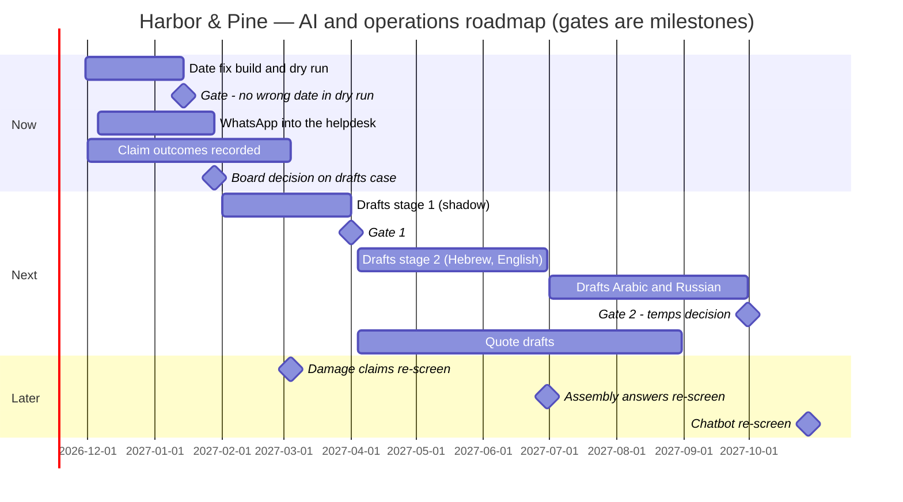

# 03.8 · The roadmap

A prioritized list is not a roadmap, and a Gantt chart with everything starting in January is not one either. A roadmap says what happens in which order, why that order (what each step proves or frees for the next), what must be true before each step starts, and whether the people who have to absorb it can. In this lesson you turn Harbor & Pine's three bets and their foundations into a one-page roadmap with horizons set by evidence, gates written as yes/no conditions, and a quarterly check against review capacity.

## The situation

Early January 2027. The ROI model ([03.7](lesson-07.md)) is with Ronit; the decision-ready case ([03.9](lesson-09.md)) goes to the board on 28 January, and the board will ask "what happens when, and what do we get by when?". The CEO already has a roadmap on the shared drive: the previous consultant's (`documents/roadmap-previous-consultant.md`) starts all seven initiatives in Q1 2027, the chatbot first, with no gates. You will pressure-test that document in lesson 07.7; here you write the one that replaces it.

IBM's roadmap course gives the vocabulary: horizons by proof maturity, gate or date, dependencies as checkable preconditions, the self-funding chain, the ledger question, review capacity per quarter, segment-by-segment scaling. This lesson applies it to one company's calendar, budget and people.

## What to do

### Step 1 — List initiatives and their foundations

Start from the alignment page (03.6): three bets (date fix, reply drafts, quote drafts), the foundations they need (WhatsApp into the helpdesk, recorded claim outcomes, the acceptable-use policy and an approved tool from module 4), and the parked items with their re-screen dates (damage-claim decisions in March 2027, assembly answers in June, the chatbot in October). Foundations go on the roadmap as initiatives with owners; if they are not on it, nobody does them, and the bets that depend on them slip without anyone being able to say why.

### Step 2 — Place by evidence, not by date

A horizon says how much is already proven and how much depends on something else:

| Horizon | Means | Harbor & Pine |
|---|---|---|
| **Now** | Measured problem, known fix, cheap and reversible, few preconditions | Date fix; WhatsApp into the helpdesk; claim outcomes recorded; guardrails (module 4) |
| **Next** | Direction evidenced, size to be measured; depends on Now | Reply drafts (needs WhatsApp routed and an approved tool); quote drafts (needs price agreements in Priority) |
| **Later** | Depends on what Next proves, or waits for data that does not exist yet | Assembly answers; damage-claim decisions; chatbot re-screen |

The chatbot is not "later" because the CEO is less important than Samir; it is later because its value depends on the date fix being live and on a test on Harbor & Pine's own data, neither of which exists yet.

### Step 3 — Write every gate as a yes/no condition, never as a date

"Drafts pilot: February" is a date. "Drafts pilot starts when every written contact arrives as a helpdesk ticket for two consecutive weeks and an approved drafting tool with a data boundary is in place" is a gate. A date tells people when to start; a gate tells them whether they may. Gates written as conditions also expose dependencies early: the WhatsApp gate depends on Meta approving a business account and moving the four numbers off the phones. As an example of what that involves, Zendesk's help page says a WhatsApp Business Account must be approved (about one to two weeks) and that a number cannot be on the WhatsApp Business mobile app and the API at the same time, so it has to be migrated (checked 2 November 2026). If that is not started in December, the February pilot cannot start, whatever the plan says.

### Step 4 — Say what each phase proves or frees for the next

Each step should fund or de-risk the next one, so the chain keeps paying for itself:

- The **date fix** frees about 120 agent-hours a month at peak (half of the October WISMO load, to be measured from January), gives the board a measured result in January, and makes every later reply, drafted or automatic, quote the right date.
- **WhatsApp into the helpdesk** makes 87% of written contact measurable for the first time, so the drafts pilot has a real baseline, and moves customer data off four shared phones.
- The **drafts pilot** builds the test set, the review routine and the "facts come from systems" pattern that the quote drafts and the assembly answers reuse; if it holds, it frees the hours that let the next peak run without temps.
- The **recorded claim outcomes** are the only route by which the damage-claim idea can ever come back.

### Step 5 — Check every quarter against absorption and review capacity

Two numbers cap each quarter. **Absorption:** what each receiving team said it can take (03.4: support 30 hours a month until February and about 60 after; logistics 12; sales 20; claims desk 4). **Central review capacity:** how many new AI uses you, Avi and counsel or the DPO can evaluate properly in a quarter. At Harbor & Pine, with one head of AI and a one-person IT team, be honest: two evaluations a quarter.

| Quarter | New AI evaluations planned | Within capacity? | Support load |
|---|---|---|---|
| Q1 2027 | Reply drafts (stage 1, shadow) | 1 of 2 | Peak until end of January; pilot from February only |
| Q2 2027 | Quote drafts; damage-claim re-screen | 2 of 2 | Drafts live, Hebrew and English first |
| Q3 2027 | Assembly answers re-screen | 1 of 2 | Arabic and Russian added after the spot-check results |
| Q4 2027 | Chatbot re-screen | 1 of 2 | **Peak: no new go-live in support from November to January** |

And one money check: Q1 is Harbor & Pine's weakest cash quarter (`company/finance-summary.md`). Stage 1 of the drafts case (₪48,000) falls in February–March; the date fix (about ₪35,000) is paid in December and January.

### Step 6 — Scale segment by segment

"It worked" describes the conditions it worked in. Roll the drafts out by segment and check only what differs each time: Hebrew and English first (most volume, the reviewers' strongest languages), then Russian and Arabic after four weeks of native-speaker spot-checks show the same error rate. Each segment is a small gate, not a new project.

### Step 7 — Add the ledger column and put it on one page

For each initiative: where the benefit lands (whose budget or whose hours) and where the residue lands (who now checks, maintains or waits). If they are in different places, it is a transfer, not a gain, and the receiving owner must have agreed it. Then draw it: a one-page table and a simple timeline that shows gates as milestones, not bars.

## Watch out

- **Everything in Q1.** The previous consultant's roadmap starts seven initiatives in the peak season and the weakest cash quarter. Count what the teams can absorb before you draw a single bar.
- **Gates written as dates.** "Phase 2 begins in April" will begin in April whether or not phase 1 worked. Write the condition.
- **Foundations off the page.** WhatsApp routing and outcome recording are not glamorous, and without them two bets cannot start. Give them owners and dates like any other initiative.
- **Ignoring the central review queue.** Five candidates that each need an evaluation, a vendor review and a DPO view will queue behind one person. If it does not fit, move it.
- **No ledger column.** A benefit that lands in support and a residue that lands in logistics is a transfer; if Tamar has not agreed her hour a week, the date fix will degrade quietly.
- **A roadmap that never changes.** Every gate result updates it. Date the version and say what changed.

## Your turn

### Inputs

- The alignment page from [03.6](lesson-06.md), the ROI model and gates from [03.7](lesson-07.md), the absorption numbers from [03.4](lesson-04.md).
- Data room (module download, `labs/common/harbor-and-pine/`): `documents/roadmap-previous-consultant.md` (for contrast), `company/company-profile.md` (seasons), `company/finance-summary.md` (cash timing, approval bands).
- Template: [roadmap](../../templates/roadmap.md).

### Steps

1. List the initiatives: bets, foundations, re-screens. Give each an owner.
2. Place each in Now, Next or Later, with the evidence and preconditions that put it there.
3. Write every gate as a yes/no condition with an owner and the date you expect to test it.
4. Write, for each initiative, what it proves or frees for the next.
5. Fill the quarterly check: evaluations against central review capacity, load against each team's absorption, cash against the weak quarter. Move what does not fit.
6. Add the ledger column and a segment plan for the drafts.
7. Put it on one page, with a timeline in which gates are milestones.

### Time

75 minutes: 15 to list and place, 20 for gates and the chain, 20 for the quarterly check, 20 to write the page.

### Done when

- [ ] Every initiative, including foundations and re-screens, has an owner and a horizon justified by evidence.
- [ ] No gate is a date; every gate is a yes/no condition with an owner.
- [ ] Each initiative states what it proves or frees for the next.
- [ ] No quarter exceeds the central review capacity or a team's absorption, and no support go-live falls in the November–January peak.
- [ ] The ledger column names where benefit and residue land, and the residue owners have agreed.
- [ ] The page is dated and versioned.

Reference answer

**Harbor & Pine — AI and operations roadmap, v1.0, 14 January 2027** (owner: Head of AI and Operations Improvement; sponsor: Michal)

| # | Initiative | Horizon (why) | Owner | Gate (yes/no) | Proves or frees for the next | Benefit lands / residue lands |
|---|---|---|---|---|---|---|
| N1 | Promised-date fix and delay emails (no AI) | Now: measured cause, plain automation, about ₪35,000 | Michal, Tamar; Avi builds | Live when two weeks of dry run show no wrong date; lead-time change agreed by Noa and Yoav (done 3 Dec) | About 120 h a month at peak (to be measured); a measured result for the board; every later reply quotes the right date | Support hours / logistics, about 1 h a week (Tamar agreed) |
| N2 | WhatsApp into the helpdesk | Now: plain integration; precondition for X1 | Avi, Samir | Business account approved; four numbers migrated; DPO view on chat history; all written contact arrives as tickets for two weeks | A real baseline for X1; customer data off shared phones | Measurement for everyone / agents learn one screen |
| N3 | Claim outcomes recorded | Now: no AI, the only route back for L2 | Rina, Samir | Outcome and reason recorded for every claim opened from 1 Dec | Labels for the damage-claim re-screen | Future option / Rina, minutes per claim |
| N4 | Acceptable-use policy, approved drafting tool, data boundary | Now: precondition for X1 (module 4) | You, Avi | Policy approved; free ChatGPT use replaced | The tool X1 runs on | Risk reduced / agents change tools |
| X1 | Reply drafts for all written contact | Next: directional value, depends on N2 and N4 | Samir; sponsor Michal | Board approval 28 Jan; gate 1 on 1 Apr (as in 03.7); Arabic and Russian after four weeks of spot-checks at the same error rate; gate 2 on 30 Sep (temps) | Test set, review routine, facts-from-systems pattern; hours that let the next peak run without temps | Support hours and the temp budget / Olga's spot-checks, about 100 h a year |
| X2 | B2B quote drafts | Next: measured time study, depends on price data | Yaniv; sponsor Yoav | Price agreements for the top 30 accounts in Priority; Priority read access; under 1% wrong price lines on 50 test quotes | Faster quotes; the pattern for supplier documents | Sales time / account managers keep prices in Priority |
| L1 | Damage-claim decisions | Later: no labels yet | Ronit, Samir | Re-screen 4 Mar 2027 with three months of complete outcomes | — | — |
| L2 | Assembly answers | Later: after X1's review routine; manuals to clean | Olga, Samir | Re-screen 30 Jun 2027; no go-live in the Nov–Jan peak | — | — |
| L3 | Chatbot | Later: depends on N1, N2 and a test on own data | Yoav, you | Re-screen 28 Oct 2027: N1 live six months, N2 done, a proof of concept on current catalogue and order data | — | — |

**Quarterly check:** as in Step 5 (evaluations 1 / 2 / 1 / 1 against a capacity of 2; support's new work 25 of 60 hours from February; no support go-live from November 2027 to January 2028; stage 1 money ₪48,000 in Q1, within Michal's ₪120,000 H1 budget).

**What changed from the previous consultant's roadmap:** the chatbot moves from first to a dated re-screen; seven Q1 starts become four foundations and one pilot; every phase has a gate; the "under 4 months" payback becomes the 22.5-month expected case with its sensitivity.

## References

- IBM, [Enterprise AI Transformation and Consulting certificate](https://www.coursera.org/professional-certificates/ibm-enterprise-ai-transformation-and-consulting), course 4 "Design AI Transformation Roadmaps" (horizons by evidence, gate or date, self-funding chain, review capacity, segment-by-segment scaling; named, not re-taught).
- Zendesk, [Adding WhatsApp channels to the Agent Workspace](https://support.zendesk.com/hc/en-us/articles/4408842821786-Adding-WhatsApp-channels-to-the-Agent-Workspace) (checked 2 Nov 2026; an example of the preconditions behind gate N2).
- Template: [roadmap](../../templates/roadmap.md).
- Next: [03.9 · The decision-ready case](lesson-09.md). Later: pressure-testing a roadmap someone else wrote (lesson 07.7) and running phase 1 (07.8).
