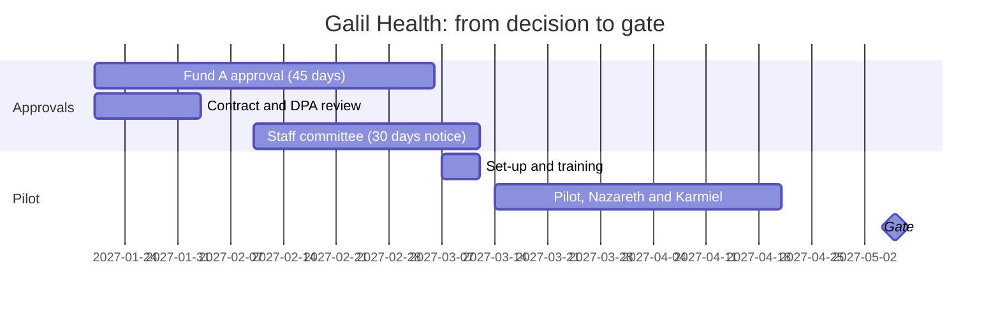

# 10.5 · Decide: scoring, contract terms and the clinician pilot

The proof of concept narrowed four vendors to one that passed every threshold. A recommendation still needs three more things: a score the steering group can trace line by line, the terms that make the contract protect patients and Galil, and a pilot plan that tests the tool in real rooms before anyone rolls it out. In this lesson you score the vendors on evidence beside their demo scores, cost them over three years, write the contract terms and the steps before signing, and design the six-week clinician pilot with its stop rules and consent wording. At the end you have the decision paper for 19 January.

> [!WARNING]
> A clinician pilot records real patients. It starts only after counsel and the DPO have approved the contract and the data flows, the health fund has approved where its agreement requires it, the cloud committee has approved the use, the staff committee has been consulted, patients have been told in their language and can refuse, and the CMO has written the stop rules. If any of these is missing on the start date, the pilot moves, not the rule.

## The situation

Sunday 3 to Thursday 14 January 2027. The PoC note went to Shlomit and Igor on 31 December; MedLink is holding its price until 31 March. The steering committee meets on Tuesday 19 January and wants one paper.

This fortnight: Hagit on the contract terms and the order of approvals ([persona](../../labs/module-10/personas/hagit-counsel-dpo.md)); Wasim on stop rules and the weekly audit ([persona](../../labs/module-10/personas/wasim-cmo.md)); Suha on what the pilot means for nurses ([persona](../../labs/module-10/personas/suha-head-of-nursing.md); [transcript](../../labs/module-10/personas/transcripts/suha-head-of-nursing.md)). And you reread what Fatma said about being recorded.

This is the [pilot charter](../module-05/lesson-01.md) with its rule of use and value measurement plan, [human review that actually checks](../module-05/lesson-05.md), [workflow redesign](../module-06/lesson-01.md) and the [comms and consultation pack](../module-06/lesson-05.md), applied to a vendor's product instead of your own build. IBM's consulting certificate calls the move from a choice to a plan *the credible counterfactual*: a pilot whose result could have come out the other way.

## What to do

### Step 1 — Score the evidence beside the demo, with a reason for every number

Use the scoring sheet (module download, `labs/module-10/rfp-scoring-sheet.csv`): one row per vendor and criterion, the demo-day score kept as it was, the evidence score beside it, and the evidence for each score. Weights as locked on 3 December (total 13).

| Criterion (weight) | ScribeWave demo → evidence | Kol Refua | MedNote for Notara | Rishma Health |
|---|---|---|---|---|
| Evidence (2) | 4 → **2** internal, scripted English; self-reported survey | 3 → **2** self-measured, 40 visits, an investor's clinic | 3 → **2** dictation figures; ambient is a "preview" | 3 → **4** independent, conversations, Arabic included |
| Safety (3) | 4 → **3** 7.2 omissions per 100; safety contact; no unsure-marking | 3 → **2** no safety case; no unsure-marking | 3 → **2** 11.1 omissions; correcting slower than writing | 3 → **4** safety case and hazard log; 2.2 omissions, 3 of 4 flagged |
| Privacy (3) | 3 → **2** Standard plan trains on data; 90-day audio; EU/US | 5 → **2** US speech API in its annex | 4 → **3** Israel, but the "product improvement" clause stays | 3 → **4** every data term accepted; Israel at +8% |
| Languages (2) | 4 → **2** Arabic word error 27% | 4 → **2** no Arabic; Russian 21% | 3 → **1** worst in all three | 3 → **4** 9 / 11 / 10% |
| Integration (1) | 4 → **3** connector; a Notara interface project | 3 → **2** no Notara experience | 5 → **5** inside Notara (two regions need an upgrade) | 2 → **3** interface project, about three months |
| Contract (2) | 3 → **2** refuses model-change notice; list-price rises | 3 → **2** 18 months' funding, no escrow | 4 → **2** year two unpriced; refuses model notice | 3 → **4** exit, model change, audit; no price lock |
| **Weighted** | 3.62 → **2.31** | 3.62 → **2.00** | 3.54 → **2.31** | 2.92 → **3.92** |

The weighted score is Σ(score × weight) ÷ 13; for Rishma (4×2 + 4×3 + 4×3 + 4×2 + 3×1 + 4×2) ÷ 13 = 51 ÷ 13 = 3.92. The demo order reverses on evidence. Every score above has a reason the vendor could read and recognise; that is what makes it defensible when ScribeWave's reseller calls the CEO.

**Test the choice, not just the score.** Would a reasonable change of weights change the answer? Give integration weight 3 (Igor's view): Rishma 3.80, MedNote 2.67. Score Rishma's integration 1 instead of 3: 3.77. Make safety and privacy ×2 instead of ×3: Rishma still first. Write one sentence: *no weighting a reasonable steering group would choose moves another vendor ahead.*

### Step 2 — Apply the must-haves as a gate

A score is a ranking; a must-have is a gate. From `poc/rfp-responses.csv`: ScribeWave refuses retention, location and model-change notice; Kol Refua refuses location; MedNote refuses no-training and model-change notice; Rishma accepts all seven. Even if Galil wanted a cheaper vendor, every other vendor would need to change a term it has already refused in writing. Say it in that order: the gate excludes three vendors; the score explains why the fourth is also the best.

### Step 3 — Cost three years and state the value honestly

Doctors first: 78 seats, not the quote's 120 (nurses are a separate decision, 10.3).

| | Year 1 | Three years | Notes |
|---|---|---|---|
| Rishma, Israel hosting (₪1,300 + 8% = ₪1,404 a doctor a month) | ₪1,314,144 + integration ₪160,000 | ≈ ₪4.22M | 3% indexation assumed, to be capped; integration estimate is Notara's |
| ScribeWave Enterprise (the plan without training; ₪1,357) | ₪1,270,152 | ≈ ₪4.09M with integration | Still refuses three must-haves |
| MedNote for Notara | ₪0 in 2027 | Unknown | Year two "to be agreed"; Notara +9% from July 2027; ₪420,000 to upgrade two regions |
| Kol Refua (₪600, three-year lock) | ₪561,600 + integration | ≈ ₪1.84M | No Arabic; audio to a US API |

The cheapest vendor fails the gate; the free one has no price after its free year and has to be bought again in the Notara renewal. In 2027 the recommended path costs about ₪0.9–1.1M (pilot from March, regions from the summer), inside the board's ₪1.6M. Value, as in 10.3: about 600 doctor-hours a month of capacity at 30 minutes a doctor-day (assumed); cash only if it keeps or fills four to five posts a year (assumed). The pilot can show direction on both; it cannot prove retention.

### Step 4 — Write the contract terms Galil will negotiate

The seven must-haves are already accepted. Add the terms that protect Galil on the points the PoC and counsel raised:

1. **Retention by instruction.** 30 days by default, but Galil may set another period once counsel answers whether audio is part of the medical record.
2. **Incident reporting within 12 hours**, because Galil must tell Fund A within 24 (Appendix D.7).
3. **Intended purpose.** Transcription and note drafting for clinician review only; no feature that suggests diagnoses, treatment or codes without Galil's written approval and a regulatory review first. (The MHRA's 2026 guidance shows why: a feature that suggests diagnoses can turn a scribe into a medical device.)
4. **Pilot exit** without penalty if a stop rule is triggered or the gate says no.
5. **No minimum seats.** 12 in the pilot, then by region.
6. **Indexation capped** (CPI, at most 4% a year); the Israel-hosting surcharge fixed for three years.
7. **Integration.** A three-party plan with Notara Systems, milestones, and fees held until the interface works on both Notara versions.
8. **Change of control.** An exit right and data return if Rishma is acquired.

You prepare these; Igor and Eyal negotiate; Hagit drafts. Regulation 15 of the Data Security Regulations asks the database owner to set the terms and supervise the outside party; these terms give Galil something to supervise against.

### Step 5 — Put the steps before signing on a timeline

The order of approvals decides the pilot's start date. Build it backwards from the dependencies, not forwards from the CEO's wish:

| Step | Owner | By |
|---|---|---|
| Contract, DPA and sub-processor list reviewed; audio-and-record question to external counsel | Hagit | 3 Feb |
| Fund A approval requested (45 days); Fund B notified (30 days) | Hagit | 20 Jan → 6 Mar |
| Cloud committee reconvened; policy adopted; risk assessment; the Ministry's sector committee if rated high risk (counsel to check timing) | Igor, Hagit | 27 Jan |
| Vendor's intended purpose in writing; counsel decides whether to consult AMAR | Hagit | 3 Feb |
| Staff committee informed in writing and consulted (nurses who interpret in a recorded visit are recorded) | Suha, HR | 10 Feb |
| Patient privacy notice updated in four languages; consent wording agreed | Hagit, Wasim | 28 Feb |
| Pilot-phase contract signed | Shlomit | after Fund A approves |
| New cloud use reported to the Ministry's information-security officer | Igor | within 30 days of signing |

Fund A's 45 days are the critical path. The pilot starts on Sunday 14 March, ends on Tuesday 20 April, before Passover, and the gate is on Thursday 6 May.

### Step 6 — Design the clinician pilot

Use the [pilot charter](../../templates/pilot-charter.md) with its rule of use and the [value measurement plan](../../templates/value-measurement-plan.md).

**Where and who.** Nazareth (Arabic; Notara 9.2; Arabic-speaking doctors writing Hebrew notes) and Karmiel (Russian and Hebrew; 9.2; 31% mismatch; the largest consumer-app uploads, so the pilot replaces unsanctioned use where it is heaviest). Six volunteer doctors in each. Both clinics are on Notara 9.2, so a later integration can be tried there first. During the pilot the doctor copies the note from Rishma into Notara; the integration project starts only after the gate.

**The comparison.** The same twelve doctors' own baseline (September–October 2026, from the audit log) and a concurrent comparison: doctors in Akko and Tiberias, with similar language mixes, read from the same audit log with no extra work for them. Without the comparison, a quiet March would look like a scribe effect.

**Rule of use.** The draft is the doctor's draft: the doctor reads it, confirms every passage marked unsure, and signs. The scribe never sends anything to the record on its own. The doctor may switch it off for any visit.

**What is measured, and the gate:**

| Measure | How | Gate threshold (6 May) |
|---|---|---|
| Documentation minutes per doctor-day | Audit log, vs baseline and comparison | ≥ 20 minutes less than the comparison |
| Omissions and invented findings | The CMO's reviewers audit 10 scribe notes per doctor per week against the audio | ≤ 3 omissions per 100 notes overall and ≤ 5 per language; ≤ 1 invented |
| Use | Share of eligible visits with the scribe, weeks 4–6 | ≥ 60% |
| Patients | Opt-out rate; complaints | ≤ 15%; no upheld complaint about recording |
| Doctors | Weekly two questions: evenings finishing notes; would you keep it? | Direction |

The weekly audit is the human-review design ([05.5](../module-05/lesson-05.md)) made concrete. A doctor who reads a fluent draft at the end of a long list will miss what the draft left out; the 2025 near misses were exactly that. The audit checks the system, not the doctor, and its results go back to the doctors every week so the unsure-marking stays meaningful.

**Stop rules (Wasim writes them; you propose).** Any harm attributable to a scribe note: stop at once and review. Audited omissions above 5 per 100 notes in a language for two consecutive weeks: stop that language. A model change without notice: stop. A data incident: stop, and Galil notifies Fund A within 24 hours. Opt-out above 30% in a clinic: pause and review the consent conversation.

**Consent.** Wasim and Hagit write it; you bring them Fatma's conditions: the doctor explains it, in the patient's language; who hears it; that it is only for the note; that it is deleted; that it doesn't go to the health fund or abroad; that saying no changes nothing. A draft: *"I'd like to use a tool that listens to our conversation so I can write your notes correctly and look at you instead of the screen. Only I see the draft, and I check it before it goes into your file. The recording is kept in Israel, is not sent to your health fund or anyone else, and is deleted within 30 days. You can say no; your visit will be exactly the same."* A poster in Hebrew, Arabic, Russian and English backs it up; the spoken sentence is the consent conversation.

**Shadow recording.** From 1 February, an instruction from the CMO: no recording of visits on personal devices or public AI tools, with no discipline for past use; pilot doctors switch to the approved tool on 14 March; everyone else is told when their region gets it. A ban with no date for an alternative sends the practice underground.

**Nurses.** Not in phase 1 as users. They are in the room: a nurse interpreting in a recorded visit is recorded. That is why the staff committee is informed and consulted 30 days ahead under the collective agreement (clause 14.1), and why the consultation should agree that recordings are never used in nurses' evaluation or discipline (clause 14.2). Ask Suha; in the transcript the interviewer never did, and missed the clause.

**Budget.** Licences 12 × ₪1,404 × 1.5 months = ₪25,272; clinician time (training 18 hours, audit reviews 48 hours, at ₪330) ≈ ₪22,000; total ≈ ₪47,000, for the CEO's approval.

Practise the scoring, the terms and the steps before signing in the simulation's `galil` preset (an educational model; it uses the same vendors and results):

[Simulation: Vendor RFP](../../simulations/vendor-rfp/index.html?preset=galil)

### Step 7 — Write the decision paper

Answer first, one recommendation, the gate and the score, the cost, the terms, the steps before signing, the pilot, what a "no" means. The recommendation the evidence supports: **name Rishma, hosted in Israel, as preferred vendor, subject to counsel's and the DPO's review, Fund A's approval, the cloud committee and the staff committee's consultation; a six-week pilot in Nazareth and Karmiel from 14 March with Wasim's stop rules; a gate on 6 May.** Recommend against signing any vendor for 120 seats before Fund A approves, and against MedNote's free year.

**Track B (Python).** Fill the evidence column of `rfp-scoring-sheet.csv`, save it as `vendor,criterion,score` and run `python poc_score.py --scores my-scores.csv` to get the weighted totals; change one weight and run it again for the sensitivity check.

## Watch out

- **Scores without reasons.** A 4 that nobody can explain loses to a vendor's phone call to the CEO.
- **Ranking past the gate.** A vendor that refuses a must-have is out; don't let a high score smuggle it back.
- **Buying all 120 seats for the pilot.** No minimum seats; pay for twelve, then by region.
- **A pilot with no comparison.** March may be quieter than October. Without a comparison group the pilot proves the calendar.
- **Stop rules written by the consultant.** They must be the CMO's, or nobody will invoke them.
- **Consent written by the vendor.** Its default wording serves the vendor. Galil's patients need Galil's words, in their language, from their doctor.
- **Forgetting who else is in the room.** Relatives and nurses are recorded too.

## Your turn

### Inputs

- `labs/module-10/rfp-scoring-sheet.csv`, `labs/module-10/poc/` (all files), your read-backs and regulatory map (10.4), the baseline sheet (10.3).
- Data room (module download): `vendors/` (prices, DPAs, safety case, offer), `legal/` (all four files), `company/clinics.csv`, `company/finance-summary.md`, `notara/visits-sample.csv` (for the pilot's baseline).
- Personas: [Hagit](../../labs/module-10/personas/hagit-counsel-dpo.md), [Wasim](../../labs/module-10/personas/wasim-cmo.md), [Suha](../../labs/module-10/personas/suha-head-of-nursing.md) or their [transcripts](../../labs/module-10/personas/transcripts/); Fatma's [transcript](../../labs/module-10/personas/transcripts/fatma-patient.md); [coach prompt](../../labs/common/coach-prompt.md).
- Templates: [pilot charter](../../templates/pilot-charter.md), [value measurement plan](../../templates/value-measurement-plan.md), [human-review design](../../templates/human-review-design.md), [comms plan](../../templates/comms-plan.md), [decision-ready case](../../templates/decision-ready-case.md), [risk register](../../templates/risk-register.md).
- Track B: `labs/module-10/poc_score.py`.

### Steps

1. Fill the evidence column of the scoring sheet with a reason per score; compute the weighted totals; run two sensitivity checks.
2. Apply the must-haves as a gate.
3. Cost the four options over three years for 78 doctors; state the value as capacity and as a retention assumption.
4. Write the contract terms to negotiate (at least six) with the reason each matters at Galil.
5. Build the steps before signing with owners and dates, and find the critical path.
6. Interview Suha about the pilot (or read her transcript and write what was missed); write the pilot plan: clinics, comparison, rule of use, measures and gate, stop rules (as a proposal to Wasim), consent wording, shadow-recording instruction, nurses, budget.
7. Write the decision paper.

### Time

180 minutes: 30 for scoring and sensitivity, 10 for the gate, 25 for cost and value, 25 for terms, 25 for the timeline, 45 for the pilot plan, 20 for the paper.

### Done when

- [ ] Every evidence score has a reason; the demo scores are kept beside them; a sensitivity check is written.
- [ ] The must-haves are applied as a gate before the ranking.
- [ ] Three-year costs are for 78 doctors, with assumptions stated; capacity and cash are separate.
- [ ] The contract terms include retention by instruction, incident timing tied to Fund A, intended purpose, a pilot exit and no minimum seats.
- [ ] The timeline puts Fund A's approval on the critical path and the pilot after it.
- [ ] The pilot plan has a comparison, a weekly safety audit, gate thresholds, the CMO's stop rules, consent wording shaped by the patient's conditions, and the staff committee's consultation.

Reference answer

The full paper is `labs/module-10/expert/05-vendor-decision-and-pilot-plan.md` in the module download. Its spine:

**Recommendation:** Rishma Health, Israel hosting, preferred vendor, subject to counsel's and the DPO's review, Fund A's approval, the cloud committee and the staff committee's consultation; pilot 14 March – 20 April 2027 in Nazareth and Karmiel, twelve doctors; gate 6 May.

**Scores (demo → evidence):** ScribeWave 3.62 → 2.31; Kol Refua 3.62 → 2.00; MedNote 3.54 → 2.31; Rishma 2.92 → 3.92. Sensitivity: Rishma's integration at 1 gives 3.77; integration weight 3 gives Rishma 3.80 and MedNote 2.67. Gate: ScribeWave refuses retention, location, model change; Kol Refua location; MedNote no-training, model change; Rishma none.

**Cost (78 doctors, three years):** Rishma ≈ ₪4.22M (₪1,314,144 a year + ₪160,000 integration, 3% indexation assumed); ScribeWave Enterprise ≈ ₪4.09M; Kol Refua ≈ ₪1.84M; MedNote unknown after 2027. 2027 cash on the recommended path ≈ ₪0.9–1.1M. Value: ≈ 600 doctor-hours a month of capacity (assumed 30 minutes a doctor-day); cash only through four to five posts kept or filled a year (assumed).

**Terms:** retention by instruction; incidents to Galil within 12 hours; intended purpose limited to transcription and drafting for review; pilot exit; no minimum seats; indexation capped at CPI, at most 4%; three-party integration plan with fees held until both Notara versions work; change-of-control exit.

**Pilot:** comparison doctors in Akko and Tiberias plus each doctor's own baseline; weekly audit of 10 notes per doctor; gate: ≥ 20 minutes less documentation per doctor-day than the comparison, omissions ≤ 3 per 100 (≤ 5 per language), invented ≤ 1, use ≥ 60%, opt-out ≤ 15%; stop rules as in Step 6 (Wasim's); consent as drafted; shadow-recording instruction and amnesty from 1 February; staff committee informed by 10 February; budget ≈ ₪47,000.

**What the Suha transcript missed:** clause 14.1 of the collective agreement (30 days' written notice and consultation before technology that records employees) and the staff committee's question about recordings in complaints against nurses.

## References

- Ministry of Health, [circular 2/2021 on cloud computing](https://www.gov.il/BlobFolder/policy/mk02-2021/he/files_circulars_mk_mk02_2021.pdf): committee approval, contract terms, reporting within 30 days of signing. Check for a later version before relying on it.
- [Privacy Protection (Data Security) Regulations, 5777-2017](https://he.wikisource.org/wiki/תקנות_הגנת_הפרטיות_(אבטחת_מידע)), regulation 15; [Patient's Rights Law, 5756-1996](https://he.wikisource.org/wiki/חוק_זכויות_החולה), sections 17 and 19. Route every reading to counsel and the DPO.
- MHRA, [Ambient voice technology-enabled products](https://www.gov.uk/government/publications/ambient-voice-technology-enabled-products/ambient-voice-technology-enabled-products) (29 July 2026): why the contract limits the intended purpose.
- Field kit: [05.1 · The pilot charter](../module-05/lesson-01.md), [05.5 · Human-in-the-loop design that actually checks](../module-05/lesson-05.md), [06.1 · Workflow redesign](../module-06/lesson-01.md), [06.5 · The comms pack](../module-06/lesson-05.md).
- Templates: [pilot charter](../../templates/pilot-charter.md), [value measurement plan](../../templates/value-measurement-plan.md), [human-review design](../../templates/human-review-design.md), [comms plan](../../templates/comms-plan.md), [decision-ready case](../../templates/decision-ready-case.md), [risk register](../../templates/risk-register.md), [RFP for AI vendors](../../templates/rfp-for-ai-vendors.md).
- Simulation: [Vendor RFP](../../simulations/vendor-rfp/index.html?preset=galil).
- Earlier: [10.4 · The hard part: choosing on evidence](lesson-04.md). Next: [10.6 · Readout and debrief](lesson-06.md).
